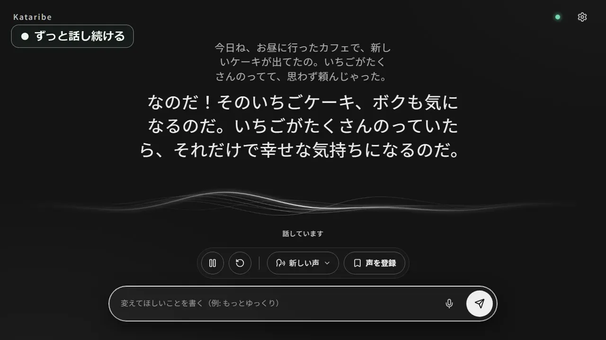

# Kataribe — リアルタイム音声読み上げアプリ

日本語 | [English](README.en.md) | [简体中文](README.zh-Hans.md) | [繁體中文](README.zh-Hant.md)

[](https://pub-9c00ef22e6f04ed2b28141d644eb0cca.r2.dev/kataribe/videos/20261103/demo-59775f93f10d.mp4)

<br>
<br>

ニュースの解説、寝る前の語り、作業中のラジオ。リクエストした内容を、止めるまで声に出して話し続けます。文章は LLM が作り、声は自分の PC の中で生成します。

## 主な機能

- **リクエストした話を、止めるまで語り続ける**
  一言リクエストすれば、自分から話し始めます。途中で「もっとゆっくり」と送れば、話の流れも話し方もその場で変わります。
- **声は言葉で指定できる**
  「落ち着いた女性の声」「聞き取りやすいニュースキャスター風」と書くだけで、その声で話します。気に入った声は名前を付けて保存でき、次からも同じ声を呼び出せます。
- **前回の続きから再開できる**
  過去の会話は一覧に残ります。保存した声のまま、続きから話を再開できます。
- **文章を書く AI を選べる**
  LM Studio、Claude Code、Codex から選べます。LM Studio なら、すべて自分の PC の中で動くので費用はかかりません。

## 音声モデルと声について

声を生成するモデルは、設定から切り替えられます。
音声の生成には [speech.cpp](https://github.com/nyosegawa/speech.cpp) を使います。標準のモデルは [Irodori-TTS](https://huggingface.co/Aratako/Irodori-TTS-500M) です。

- **Irodori-TTS**：日本語。標準のモデルです。文章で声を作って保存できます。
- **Qwen3-TTS**：10 言語（日本語・英語・中国語・韓国語ほか）。aiden、ryan、serena など 9 種類の声から選びます。「ゆっくり」「低く落ち着いて」といった話し方の指示も反映されます。
- **Drama 3**：83 言語。手元の録音から声を作って話せます。商用では使えません。モデルの容量は約 20.8GB です。

## 動作環境

- 対応 OS: Windows、macOS（Apple Silicon）
- Python 3 が必要です
- 声の生成には GPU を使います。NVIDIA RTX 3060 では、数秒の音声を約 0.5 秒で生成できます。

## 使い方

### 1. インストールと起動

**Windows**

```bash
git clone https://github.com/ADA-Software-JP/kataribe
cd kataribe
python -m pip install -r requirements.txt
python server.py
```

**macOS**

```bash
git clone https://github.com/ADA-Software-JP/kataribe
cd kataribe
python3 -m venv .venv
source .venv/bin/activate
python -m pip install -r requirements.txt
python server.py
```

### 2. 初回セットアップ

初回起動時にセットアップ画面が表示されます。実行すると、音声合成エンジンの `speech.cpp` とデフォルトの音声モデル（約1.9GB）が自動でダウンロードされます。

### 3. アプリ化（任意）

Pythonコマンドからではなく、単体のアプリとして起動したい場合は手元でビルドできます。
以下を実行すると、Windowsは `dist/Kataribe/`、macOSは `dist/Kataribe.app` が作成されます。

```bash
python -m pip install pyinstaller
python -m PyInstaller --noconfirm --clean Kataribe.spec
```

詳しい設定やコマンド操作については [docs/guide.ja.md](docs/guide.ja.md) に記載しています。

## ライセンス

[Apache License 2.0](LICENSE)
[speech.cpp](https://github.com/nyosegawa/speech.cpp) や [Irodori-TTS](https://huggingface.co/Aratako/Irodori-TTS-500M) などの各音声モデルは、それぞれのライセンスに従います。
