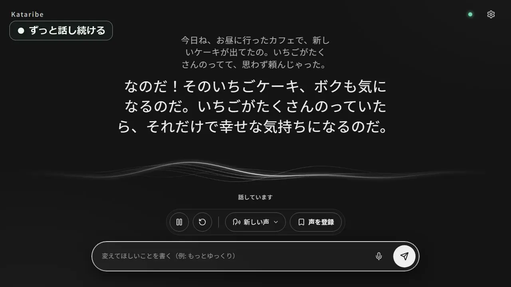

# Kataribe — 即時語音朗讀應用程式

[日本語](README.md) | [English](README.en.md) | [简体中文](README.zh-Hans.md) | 繁體中文

[](https://pub-9c00ef22e6f04ed2b28141d644eb0cca.r2.dev/kataribe/videos/20261103/demo-59775f93f10d.mp4)

<br>
<br>

新聞解說、睡前故事、工作時的電台閒聊。只要說一句需求，Kataribe 就會一直說下去，直到你停止。文稿由 LLM 撰寫，聲音在你自己的電腦上產生。

## 主要功能

- **一直說到你叫停**
  想聽新聞解說、助眠故事或電台式閒聊，說一句它就會開始。中途傳一句「再慢一點」，故事走向和說話方式會立刻改變。
- **用文字描述聲音**
  寫下「沉穩溫柔的女聲」「清晰易懂的新聞主播」，它就用那樣的聲音說話。喜歡的聲音可以取名儲存，下次直接叫出。
- **從上次的地方繼續**
  過去的對話會儲存在清單裡，可以用儲存的聲音接著說。
- **自選撰寫文稿的 AI**
  可選擇 LM Studio、Claude Code 或 Codex。使用 LM Studio 時，一切都在你的電腦裡完成，無需任何費用。

## 關於語音模型和聲音

產生聲音的模型可以在設定中切換。
語音由 [speech.cpp](https://github.com/nyosegawa/speech.cpp) 產生，預設模型為 [Irodori-TTS](https://huggingface.co/Aratako/Irodori-TTS-500M)。

- **Irodori-TTS**：日語。預設模型。用文字描述就能建立聲音並儲存。
- **Qwen3-TTS**：10 種語言（含英語、中文、日語、韓語）。從 aiden、ryan、serena 等 9 種內建聲音中選擇。「慢一點」「低沉平靜」等說話方式的指示會生效。
- **Drama 3**：83 種語言。可以用你自己的錄音製作聲音並讓它說話。不可用於商業用途。模型約 20.8GB。

## 執行環境

- 支援的系統：Windows、macOS（Apple Silicon）
- 需要 Python 3
- 聲音由 GPU 產生。在 NVIDIA RTX 3060 上，幾秒的語音約 0.5 秒即可產生。

## 使用方法

### 1. 安裝與啟動

**Windows**

```bash
git clone https://github.com/ADA-Software-JP/kataribe
cd kataribe
python -m pip install -r requirements.txt
python server.py
```

**macOS**

```bash
git clone https://github.com/ADA-Software-JP/kataribe
cd kataribe
python3 -m venv .venv
source .venv/bin/activate
python -m pip install -r requirements.txt
python server.py
```

### 2. 首次設定

首次啟動時會顯示設定畫面。執行後，會自動下載語音合成引擎 `speech.cpp` 和預設語音模型（約 1.9GB）。

### 3. 打包成應用程式（選用）

如果想作為獨立應用程式啟動，而不是透過 Python 指令啟動，可以自行建置。
執行以下指令後，Windows 會產生 `dist/Kataribe/`，macOS 會產生 `dist/Kataribe.app`。

```bash
python -m pip install pyinstaller
python -m PyInstaller --noconfirm --clean Kataribe.spec
```

詳細設定和指令列操作請參閱 [docs/guide.zh-Hant.md](docs/guide.zh-Hant.md)。

## 授權

[Apache License 2.0](LICENSE)
[speech.cpp](https://github.com/nyosegawa/speech.cpp)、[Irodori-TTS](https://huggingface.co/Aratako/Irodori-TTS-500M) 等各語音模型遵循各自的授權。
